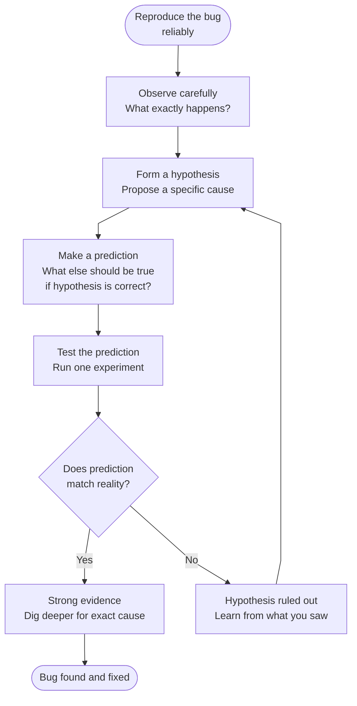

import TawkWidget from '../../../../components/TawkWidget.astro';
import UniversalContentContributors from '../../../../components/UniversalContentContributors.astro';
import InArticleAd from '../../../../components/InArticleAd.astro';
import Copyright from '../../../../components/Copyright.astro';
import BionicText from '../../../../components/BionicText.astro';
import TailwindWrapper from '../../../../components/TailwindWrapper.jsx';
import { Tabs, TabItem } from '@astrojs/starlight/components';
import { Card, CardGrid, Badge, Steps, LinkButton, FileTree } from '@astrojs/starlight/components';

<UniversalContentContributors 
  contributors={frontmatter.contributors}
/>


import CriticalThinkingEngineersComments from '../../../../components/critical-thinking-engineers/CriticalThinkingEngineersComments.astro';

A borehole pump trips twice a week. Over a month the technician replaces the overload relay, then the contactor, then the level switch. The pump still trips, 900 USD of parts are gone, and nobody knows more than on the first day. The parts were not the problem. The method was: change something and hope. This lesson gives you the method that finds faults in pumps, cold rooms, circuits and programs alike: state a cause, predict what you would see if it were true, test that one thing, and halve the search at each test. #Debugging #ScientificMethod #CriticalThinking

## Debugging IS the Scientific Method

Debugging means finding the cause of a fault. A hypothesis is a proposed cause, stated so clearly that a test can prove it wrong. Scientists and fault finders follow the same steps:

| Scientific method | Finding a fault |
|-------------------|-----------|
| Observe | Note the symptom exactly: the pump trips after about 20 minutes of running |
| Form a hypothesis | Propose one cause: "the motor draws too much current because the impeller is partly blocked" |
| Make a prediction | "If so, the running current is above the nameplate value from the first minute, and rises" |
| Test the prediction | Read the current with a clamp meter during one run |
| Update the hypothesis | The current is normal until the trip, so the cause is something else. One suspect is removed |

You do not "look for the fault". You name one cause, work out what else must be true if you are right, and check that. A wrong prediction is still progress, because it removes a suspect for good.

### Why This Matters

Changing parts without a hypothesis is like searching for lost keys by walking through the house at random. Working by hypothesis is like searching room by room and marking each room as checked. Both may find the keys. Only one tells you where they are not.

## The Debugging Loop

<InArticleAd />


The loop has six steps. The chart shows the order, and the list below follows one fault through it.



<Steps>
1. **Reproduce the fault.** If you cannot make the fault happen when you want, you cannot test a hypothesis about it. Find the smallest set of conditions that causes it: "the pump trips only when the tank is nearly full and the afternoon is hot".

2. **Observe carefully.** Not "it trips", but "the overload relay trips after 18 to 22 minutes, only between 13:00 and 16:00". Details remove hypotheses before you test anything.

3. **Form a hypothesis.** Propose one cause that fits every detail: "the relay sits in a panel in full sun, and the heat of the panel adds to the heat of the motor current".

4. **Make a prediction.** If the hypothesis is correct, what else must be true? "With the panel shaded, the pump will run through the afternoon at the same current without a trip."

5. **Test the prediction.** Change that one thing. Shade the panel for three afternoons and log the current.

6. **Update and repeat.** If the trips stop, you have strong evidence, and you can look for the lasting fix. If they continue, the hypothesis is wrong. Form a new one from what you saw.
</Steps>

### Writing It Down

Keep a log of the search, even a few timed lines in a notebook. It stops you testing the same hypothesis twice, it records what you have ruled out, and writing a hypothesis down forces you to make it clear.

## Binary Search: Divide and Conquer

<InArticleAd />


Binary search means that each test splits the remaining suspects into two halves and tells you which half holds the fault. You do not check the suspects one after another.

### A worked case: eight stages, three tests

A tank is 4.0 m deep. A dipstick shows 2.0 m of water, but the screen in the office shows 1.2 m. The level signal passes through eight stages on its way to the screen, and one of them is wrong:

```text
 1 sensor     2 cable      3 surge      4 input
 in the  ---> to the  ---> protector -> card of the
 tank         panel                     controller
                                             |
 8 screen <-- 7 network <- 6 scaling <- 5 value in
 in office                 to metres    controller
```

The sensor sends a current of 4 mA for an empty tank and 20 mA for a full one. At 2.0 m of 4.0 m the tank is half full, so the correct signal is $4 + 16 \times 2.0 / 4.0 = 12.0$ mA.

Checking from the sensor, one stage at a time, can take seven measurements. Halving takes three:

<Steps>
1. **Test after stage 4, the middle.** The input card reads 12.0 mA. Stages 1 to 4 are good. Four suspects remain: 5, 6, 7, 8.

2. **Test after stage 6, the middle of what remains.** The scaled value is 1.2 m. It is already wrong, so stages 7 and 8 are not the cause. Two suspects remain: 5 and 6.

3. **Test after stage 5.** The controller holds 50%, which is correct for 12.0 mA. Only stage 6 remains.
</Steps>

Stage 6 turns the percentage into metres. Its range was entered as 2.4 m, not 4.0 m, and 50% of 2.4 m is 1.2 m. The cause was one wrong number, found with three readings and no parts replaced.

Halving needs two things: the stages must be in a known order, and you must know the correct value at the point you test. That is why the first step was to calculate 12.0 mA.

### Git Bisect

The same search works on the history of a program. Git, the tool that stores each saved version (a commit) of a program, has it built in. If version 100 worked and version 200 is broken, the bug entered in one of 100 commits. Test version 150. If it works, the bug is between 150 and 200, so test 175, and continue. You find the exact commit in about 7 tests, not 100.

```bash
# Git has this built in
git bisect start
git bisect bad          # current version is broken
git bisect good v1.0    # this version was known good

# Git checks out the midpoint. You test and report:
git bisect good         # or "git bisect bad"

# After ~7 steps, git tells you the exact commit
```

### Printf Bisect

Inside one program the method is the same. If a function gives a wrong result, print the value in the middle of the function. If the value is correct there, the bug is in the second half. If not, it is in the first half. Divide again.

<Card title="The Power of Halving" icon="rocket">
Each test removes half of the suspects, so the number of tests grows very slowly. With 1,000 possible causes, checking one by one can take 1,000 tests and halving takes about 10. With 1,000,000 causes, halving takes about 20. Before each test, ask: "Can one measurement cut the suspects in half?"
</Card>

## Rubber Duck Debugging Is the Socratic Method

<InArticleAd />


Rubber duck debugging means explaining the problem aloud, step by step, to an object such as a toy duck. It works because it makes you examine what you assume.

While the system is only in your head, you pass over the parts you believe you understand. When you must say each step aloud ("the float switch closes, so the contactor pulls in, so... wait, what if the timer has not finished?"), every assumption has to be stated. This is the method of Socrates: he did not give his students the answer. He asked them to explain their reasoning step by step until the weak step showed itself.

### How to Rubber Duck Effectively

<Steps>
1. Open the program, the wiring diagram or the piping drawing.
2. Explain aloud what each part is supposed to do.
3. At each step, ask: "Have I checked this, or do I only believe it?"
4. The step you cannot explain with confidence is the first place to test.
</Steps>

A colleague who does not know your system works as well as a duck. So does writing.

### Why Writing Bug Reports Helps You Debug

A fault report, even one that nobody else reads, makes you do the same work. A good one has four parts:

- What you expected to happen. This shows your assumptions.
- What happened. This makes you observe exactly.
- The steps that cause the fault. This makes you find the smallest set of conditions.
- What you have already tried. This stops you repeating a test.

Many people find the cause while they write the report.

## Common Debugging Fallacies

<InArticleAd />


A fallacy is a piece of reasoning that sounds right and is not. These five waste the most time.

### "The Compiler Has a Bug"

<Card title="It Is Almost Never the Tool" icon="warning">
A compiler, the program that turns your code into machine instructions, is used by a very large number of people. So is a well known software library, and so is a multimeter from a known maker. Your code, your wiring or your setting was made by one person, today, perhaps while tired. When the result is strange, suspect your own work first.
</Card>

### "The Hardware Is Broken"

A new pump, sensor or controller was tested before it left the factory. Unless you can see damage, it is more likely that the fault is in what was done on site: a wire in the wrong terminal, a setting left at its default, a pipe that leaks air. Order a replacement only after a test has pointed to the part.

### "It Worked Yesterday" and "I Did Not Change Anything"

"It worked yesterday" is useful: something changed between then and now, so the search is limited to recent changes. "I did not change anything" usually means "nothing changed that I know of". Make a list of what could have changed without you:

- A software update installed in the night, or a colleague's change.
- The weather, the load or the supply voltage.
- A part that aged: a battery that lost charge, a connector that corroded, a filter that filled.

### "It Should Not Be Possible"

This sentence means "my picture of the system does not predict this". The system is doing what its wiring, settings and program make it do. The error is in your picture, and finding where the picture is wrong is the search.

### Confirmation Bias in Debugging

Once you have a hypothesis, you notice the evidence that supports it and pass over the rest. A test with an unclear result looks like proof. A log line that points to a different cause is not read.

The counter is to try to prove yourself wrong. Ask "what result would show that my hypothesis is false?" If no result could, the hypothesis is too vague to test.

## Hypothesis-Driven vs. Random-Change Debugging

<InArticleAd />


When you are tired, it is tempting to change things and watch: swap this relay, move that line of code, raise that setting. This is gambling. Sometimes it wins, and the win teaches you to do it again.

### The Problem With Random Changes

<Tabs>
<TabItem label="Random Changes">
- A change that did not help teaches you nothing.
- If a change removes the fault, you do not know why.
- Each change can add a new fault.
- You cannot explain the repair to anyone.
- The change may hide the fault and leave its cause in place.
</TabItem>
<TabItem label="Hypothesis-Driven">
- Every test removes at least one possible cause.
- When the fault is gone, you know its cause.
- You change little, so you add few new faults.
- You can explain the repair and teach it.
- You can write a test that catches the same fault if it returns.
</TabItem>
</Tabs>

## Root Cause vs. Workaround

<InArticleAd />


A workaround makes the symptom go away. A root cause fix removes what produced the symptom.

| Workaround | Root cause fix |
|------------|---------------|
| Reset the overload relay each morning | Find why the motor draws too much current |
| Add oil to the gearbox every week | Replace the seal that leaks |
| Restart the program every 4 hours before it stops | Fix the code that uses more memory each hour |
| Read the sensor again when a reading fails | Find why the reading fails |

### When Workarounds Are Acceptable

A workaround is sometimes the right choice:

- **Time pressure.** The cold room is warming and stock is at risk. Apply the workaround now and find the cause after.
- **The cause is not yours to fix.** If the fault is in a supplier's product and the fix is months away, a workaround on your side is reasonable.
- **The fix costs more than the fault.** If the fault appears only in a condition that almost never occurs, a written note may be better than a large rebuild.

Always record a workaround, and keep the search for the cause as a separate open task. A workaround that is not recorded becomes permanent.

### The Five Whys

The Five Whys method, developed at Toyota, leads from a symptom to a root cause. Ask "why?" again and again until you reach a cause whose removal stops the problem from returning.

<Steps>
1. **Why did the pump stop?** The overload relay tripped.
2. **Why did it trip?** The motor drew too much current.
3. **Why did it draw too much current?** Sand had partly blocked the impeller, the rotating part that moves the water.
4. **Why was there sand in the pump?** The pump was set 3 m lower after the last service, close to the bottom of the borehole.
5. **Why was it set lower?** The setting depth was not written down, so the crew guessed.
</Steps>

Cleaning the impeller deals with the symptom. Raising the pump deals with this fault. Recording the setting depth at every service prevents the same kind of fault on every borehole. Five is not a rule: stop when you reach a cause that you can change and that prevents a repeat.

## War Stories: Debugging in the Real World

<InArticleAd />


These three cases are of a kind that fault finders meet often. Each shows one trap.

### The fault that keeps a timetable

A cold room gives a high temperature alarm on most afternoons. The crew suspects the door seal, then the heat of the day, and replaces the seal. The alarms continue. A log of alarm times shows that each one starts within a few minutes of 14:00. The cause is the defrost timer: it stops cooling at 14:00 each day to melt the ice on the cooling coil, and the alarm limit is set too close to the normal temperature.

The lesson: a fault that follows the clock points to something that is scheduled. Log the times before you form a hypothesis.

### The fault that hides when you watch

A program for a small controller works when it runs under the debugger, the tool that lets you stop a program and look inside it, and stops at once when it runs alone. The team suspects timing. The cause is different: the debugger set all memory to zero at the start, and without it the memory starts with random values. One variable was never given a start value.

The lesson: the act of observing can change the system. A pressure gauge adds a small volume, a meter loads a circuit, a debugger changes the start conditions. Ask what your instrument changes.

### The retry that hid two faults

A sensor gives a correct reading 99% of the time and sometimes returns a value that is clearly wrong. The team adds a retry: read again when the value is wrong. The wrong values disappear. Months later the same sensor is found to return old readings that look correct. The clock of the data line was a little too fast for the sensor when it was warm, and the program did not check the sensor's signal that a transfer had failed.

The lesson: a retry is a workaround. It hid the symptom that would have led to the cause, and the cause then produced a fault that was harder to see.

## Building a Debugging Toolkit

<InArticleAd />


### Minimizing the Reproduction Case

Reduce the system to the smallest version that still shows the fault. If a program of 10,000 lines stops, can 100 lines show the same stop? If a pump trips, does it still trip with the tank valve shut, or on a cool morning?

Each part you remove without losing the fault was not the cause. When removing a part makes the fault disappear, that part is involved. A quick way to do this is to remove half, test, keep the half that still fails, and repeat.

### Logging vs. Breakpoints

Logging means that the system writes down values as it runs. A breakpoint stops a program at a chosen line so that you can look at its values.

<Tabs>
<TabItem label="When to Use Logging">
- The fault comes rarely and you cannot cause it when you want.
- The system has several machines or sites.
- Timing matters, and stopping the system would change its behaviour.
- You want a record to study after a failure.
- The system is in service and must not stop.
</TabItem>
<TabItem label="When to Use Breakpoints">
- You can cause the fault whenever you want.
- You need to look at many values at one moment.
- You want to follow the program line by line.
- You want to change a value while the program is stopped, to test a hypothesis.
</TabItem>
</Tabs>

Use logging to find where the fault is, then a closer look at that place. For a pump or a cold room, logging is often the only choice: a record of current, pressure and temperature against time shows what happened at 03:00 when nobody was there.

### The Power of Assertions

An assertion is a line of code that states something you believe and stops the program if it is false. `assert(buffer != NULL)` says "this pointer always points to something here". If you are wrong, the program stops at that line and names the false assumption. Without it, the program would fail later, somewhere else.

Add assertions when you write the code. An alarm limit does the same work in a plant: "the suction pressure is never below 1 bar" is an assumption, and an alarm tells you the moment it becomes false.

## When to Ask for Help

<InArticleAd />


<Steps>
1. **After 30 minutes without progress,** explain the problem aloud to someone, or to the duck.
2. **After 2 hours without progress,** rest. Walk or eat. Then write down everything you "know" about the fault and check each item: "I know the supply is correct." Have you measured it?
3. **After half a day without progress,** ask a colleague. Say what you tried, what you ruled out and what your best hypothesis is.
4. **Before you ask,** prepare the symptom, the conditions, what you expected and what you tried. "It does not work, can you help?" wastes two people's time.
</Steps>

Asking is a good use of what a team knows. A clear statement of the problem is what makes the answer fast.

## Exercises

<InArticleAd />


1. **Practice the debugging loop.** Put a known fault into something simple: a wrong setting in a controller on the bench, or a small program with a deliberate bug. Give it to a colleague and watch. Do they state a hypothesis and a prediction, or do they start to change things?

2. **Git bisect exercise.** Create a git repository with 20 commits. Introduce a bug in commit 10. Use `git bisect` to find the exact commit. How many steps did it take?

3. **Halve a real chain.** Choose one reading at your site, such as a tank level or a room temperature. Draw every stage from the sensor to the screen. Mark where you could measure the signal, and write the correct value at each point for one known condition.

4. **Debugging log.** At the next real fault, write each hypothesis, prediction, test and result. Afterwards, count the hypotheses that were wrong. Did the log stop you repeating a test?

5. **Minimize a reproduction case.** Take a program of a few hundred lines with a known bug. Reduce it to the smallest program that still shows the bug. Record what each removal told you.

6. **Five Whys.** Take a recent fault from your work. Ask "why?" until you reach a cause that can be changed. Is it one person's error, or something in the way the work is organised?

## Summary

<InArticleAd />


Finding a fault is the scientific method on a small scale: observe, state a hypothesis, predict, test one thing, update. Halving the suspects at each test finds one fault among eight stages in three tests and one among a million in about twenty. Explaining the system aloud exposes what you assumed. Blaming the tool or the hardware, and changing things at random, cost the most time. A workaround hides a symptom, so record it and keep looking for the cause.

## Seen in the field

<InArticleAd />


Reasoning backwards from a symptom to its cause is the same skill in software and at a borehole. A submersible pump ran dry for forty five minutes and still filled its tank on schedule. Every obvious sign said the system was healthy, and the fault showed only in a reading that fell when it should have risen. The case is worked through in [the pump that ran dry](/blog/remote-monitoring/borehole-and-storage-tank/).

<CriticalThinkingEngineersComments />


<InArticleAd />
<TawkWidget />
<Copyright />