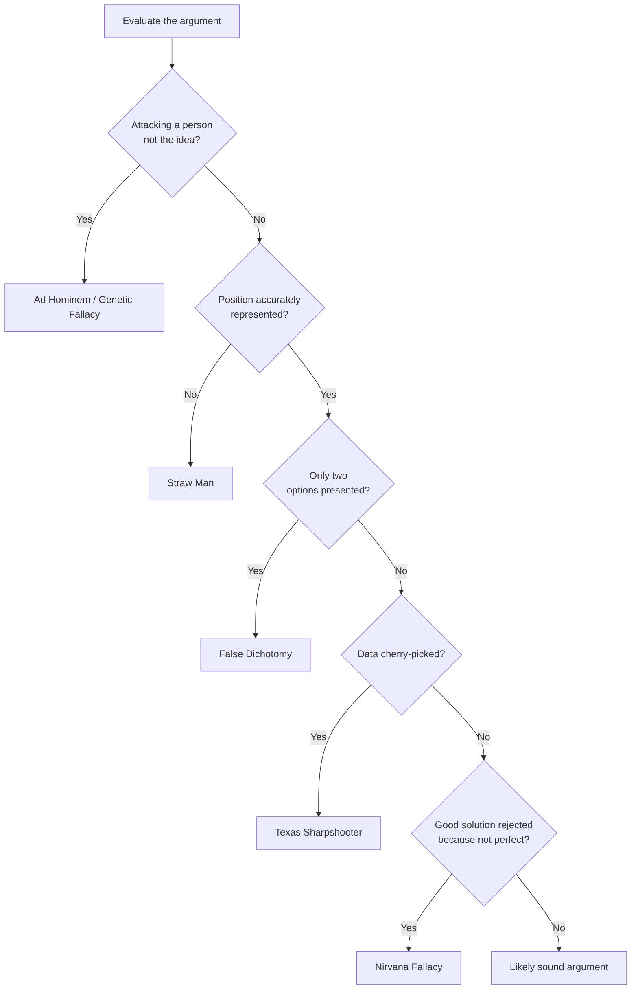

import TawkWidget from '../../../../components/TawkWidget.astro';
import UniversalContentContributors from '../../../../components/UniversalContentContributors.astro';
import InArticleAd from '../../../../components/InArticleAd.astro';
import Copyright from '../../../../components/Copyright.astro';
import BionicText from '../../../../components/BionicText.astro';
import TailwindWrapper from '../../../../components/TailwindWrapper.jsx';
import { Tabs, TabItem } from '@astrojs/starlight/components';
import { Card, CardGrid, Badge, Steps, LinkButton, FileTree } from '@astrojs/starlight/components';

<UniversalContentContributors 
  contributors={frontmatter.contributors}
/>

import CriticalThinkingEngineersComments from '../../../../components/critical-thinking-engineers/CriticalThinkingEngineersComments.astro';

A supplier tells your manager that a fuel saving device "cut fuel use by 15% at three customer sites", and the purchase is approved in the same meeting. Nobody asked how many sites were tried. The claim may even be true, but the argument for it is broken, and a broken argument gives you no reason to believe its conclusion. Such an argument is called a fallacy. This lesson shows the fallacies that appear most often in meetings, reviews and sales claims, with a calm answer to each. #CriticalThinking #LogicalFallacies #Engineering

## What Makes an Argument Valid?

An argument has premises (the statements it starts from) and a conclusion. Three words describe it:

- An argument is **valid** when the conclusion must be true if the premises are true.
- An argument is **sound** when it is valid and its premises really are true.
- A **fallacy** is an argument whose conclusion does not follow from its premises. The conclusion may still be true by luck. The argument simply gives it no support.

<Card title="Why Fallacies Matter in Engineering" icon="star">
In a meeting, the most persuasive argument wins, and it is not always the best technical answer. If the winning argument holds a fallacy, your team may choose the worse option. If you cannot say what is wrong with a bad reply to your own good argument, you lose although you are right.
</Card>

## Fallacies That Attack the Person or Source

<InArticleAd />

### Ad Hominem (Attack the Person)

**Definition:** Rejecting an argument by attacking the person who makes it, in place of the argument.

<Tabs>
  <TabItem label="Engineering Example">
    A new operator says the stroke setting of the chlorine dosing pump looks too high for the flow. The supervisor answers: "You have been here three months. You do not know this plant." How long the operator has worked there does not change the dose. The setting can be checked against the flow in ten minutes.

    A close relative is the genetic fallacy: judging an idea by where it came from ("that procedure came from the night shift, so ignore it").
  </TabItem>
  <TabItem label="How to Counter">
    Return to the claim: "That is true about my experience. Can we check the setting against today's flow?" In your own thinking, ask: "Would I accept this argument if another person made it?"
  </TabItem>
</Tabs>

### Appeal to Authority

**Definition:** Accepting a claim because a person of rank or fame said it, with no supporting evidence.

<Tabs>
  <TabItem label="Engineering Example">
    "The chief engineer says vibration checks are a waste of time on small motors, so we do not do them." The chief engineer may be right. But rank is not the evidence. The evidence is in the failure records: how many small motors failed last year, what each failure cost, and how many of them a check would have found.
  </TabItem>
  <TabItem label="How to Counter">
    Separate the person from the claim: "What do our failure records say about small motors?" An expert's opinion is a good reason to look at the evidence. It does not replace it.
  </TabItem>
</Tabs>

## Fallacies That Distort the Argument

<InArticleAd />

### Straw Man

**Definition:** Changing another person's argument into a weaker one, then attacking the weaker one.

<Tabs>
  <TabItem label="Engineering Example">
    **Technician A:** "We should record the cold room temperature every five minutes."

    **Manager B:** "So you want staff to sit and watch a screen all day and stop doing their real work? We cannot afford that."

    A proposed an automatic record. B changed it into "staff watching screens", which is easy to reject and was never proposed.
  </TabItem>
  <TabItem label="How to Counter">
    State the original argument again, exactly: "I did not suggest that anyone watches a screen. A logger records the temperature by itself, and staff look only when it sends an alarm."
  </TabItem>
</Tabs>

### Red Herring

**Definition:** Bringing in a subject that has nothing to do with the question, so that attention moves away from it.

<Tabs>
  <TabItem label="Engineering Example">
    **Engineer A:** "The generator uses 12% more fuel for each kWh since the last service. We should find out why."

    **Engineer B:** "It has started first time on every test this quarter. That is better than last quarter."

    Reliable starting is true and good, and it is a different measurement. It says nothing about the fuel.
  </TabItem>
  <TabItem label="How to Counter">
    Accept the point and return: "Good news on starting. The question here is the 12% on fuel. Can we stay with that?"
  </TabItem>
</Tabs>

### Equivocation

**Definition:** Using one word with two meanings and changing between them inside the argument.

<Tabs>
  <TabItem label="Engineering Example">
    "The pressure sensor is accurate to 1%, so our 5 bar reading is good to 0.05 bar." The word "accurate" is doing two jobs. On most datasheets 1% means 1% of the full range. For a 0 to 100 bar sensor that is 1 bar, which is 20% of a 5 bar reading, not 1% of it.
  </TabItem>
  <TabItem label="How to Counter">
    Ask for the exact meaning: "Is that 1% of the reading or 1% of full scale?" Many arguments end when the two sides find they were using one word for two things.
  </TabItem>
</Tabs>

## Fallacies That Limit Options

<InArticleAd />

### False Dichotomy (Either/Or Fallacy)

**Definition:** Presenting only two options when more exist.

<Tabs>
  <TabItem label="Engineering Example">
    "Either we rewrite the entire system in Rust, or we accept that we will keep having memory safety bugs in C." This leaves out many options between the two: static analysis tools, a safer C coding standard, a rewrite of only the most critical modules, or memory checks at run time.
  </TabItem>
  <TabItem label="How to Counter">
    Name the missing options: "Those are not the only two choices. We could also run a memory checker on every build, or rewrite only the network code."
  </TabItem>
</Tabs>

### Nirvana Fallacy (Perfect Solution Fallacy)

**Definition:** Rejecting a practical solution because it is not perfect.

<Tabs>
  <TabItem label="Engineering Example">
    "There is no point fitting a dry run cut-out to the borehole pump. It will not protect the motor from a lightning surge." True, and beside the point. Dry running and surges are different causes of failure, and removing one of them is worth doing while the other remains.
  </TabItem>
  <TabItem label="How to Counter">
    Accept the limit and count: "You are right, it does nothing for surges. How many of our last ten pump failures were dry running? Those are the ones it stops."
  </TabItem>
</Tabs>

### Slippery Slope

**Definition:** Claiming that one small step must lead to an extreme result, with no evidence for the steps between.

<Tabs>
  <TabItem label="Engineering Example">
    "If we allow one exception to the coding standard, soon everyone will ignore the standard and nobody will be able to maintain the code." The argument jumps over everything that would stop the slide: reviews, automatic checks, and the team's own habits.
  </TabItem>
  <TabItem label="How to Counter">
    Ask for the chain: "What exactly would make one exception lead to the next? The automatic checks stay in place. Can we allow this one and write down why?"
  </TabItem>
</Tabs>

## Fallacies That Misuse Evidence

<InArticleAd />

### Appeal to Common Practice (Bandwagon)

**Definition:** Arguing that something is right or good because many people do it.

<Tabs>
  <TabItem label="Engineering Example">
    "Every farm in this area uses that pump brand, so we should too." It may be popular because it is good, or because one dealer is near, or because the first farm bought it and the others copied. Popularity is a reason to look closely. It does not tell you that the pump fits your depth and your flow.
  </TabItem>
  <TabItem label="How to Counter">
    Move from popularity to fit: "What head and flow do we need, and where does that point sit on this pump's curve?"
  </TabItem>
</Tabs>

### Appeal to Tradition

**Definition:** Arguing that something should continue because it has always been done that way.

<Tabs>
  <TabItem label="Engineering Example">
    "We have always changed the generator oil every 250 hours. There is no reason to look at it again." The interval was chosen for the old duty. If the generator now runs in a dusty yard, 250 hours may be too long. If it has become a standby set that runs 50 hours a year, the same rule leaves the oil in for five years.
  </TabItem>
  <TabItem label="How to Counter">
    Respect the history and ask about today: "The 250 hours served us well. What do the maker's manual and an oil sample say for the way we run it now?"
  </TabItem>
</Tabs>

### Texas Sharpshooter Fallacy (Cherry-Picking Data)

**Definition:** Choosing the results that agree with you from a larger set and presenting only those. The name comes from a man who shoots at a wall and then paints the target around the holes.

<Tabs>
  <TabItem label="Worked Case">
    A supplier fits a fuel saving device to the generators at 20 sites for one month and reports: "Fuel use fell by 15% at three sites." You ask for all 20 results. The change in fuel use at each site was:

    | Sites | Change in fuel use |
    |-------|--------------------|
    | 3 | -14%, -15%, -16% |
    | 12 | between -3% and +3% (these twelve add up to 0) |
    | 5 | +4%, +4%, +5%, +6%, +7% |

    Add all twenty: $(-45) + 0 + (+26) = -19$. The average is $-19 / 20 = -0.95\%$, so fuel use fell by about 1% across all sites.

    The claim of 15% was true for three sites and false as a description of the device. A change of 1% is smaller than what the weather and the load do to a generator from one month to the next. And five sites used more fuel, which nobody mentioned.
  </TabItem>
  <TabItem label="How to Counter">
    Ask one question before any other: "How many did you try?" Then ask for every result, including the bad ones. In your own reports, give the whole set: "20 sites: 3 fell by about 15%, 12 did not change, 5 rose by 4% to 7%."
  </TabItem>
</Tabs>

### Circular Reasoning (Begging the Question)

**Definition:** The conclusion is already inside the premises.

<Tabs>
  <TabItem label="Engineering Example">
    "This is the most reliable pump because it is the one that breaks down least." "Reliable" and "breaks down least" mean the same thing, so the sentence says the claim twice and supports it with nothing.
  </TabItem>
  <TabItem label="How to Counter">
    Ask for evidence from outside the claim: "What failure records or test results is that based on?"
  </TabItem>
</Tabs>

## Fallacies That Shift the Burden

<InArticleAd />

### Burden of Proof

**Definition:** Claiming that something is true because nobody has shown it to be false. This is also called the argument from ignorance. It moves the work of proof onto the person who doubts.

<Tabs>
  <TabItem label="Engineering Example">
    "The earth leakage relay has never tripped, so the wiring is healthy." A relay that has never tripped may be watching healthy wiring, or it may be a relay that cannot trip. No evidence of a fault is not the same as evidence of no fault. The person who claims the wiring is healthy must show it, for example with the relay's own test button and an insulation test by a licensed electrician.
  </TabItem>
  <TabItem label="How to Counter">
    Ask what was looked for: "When was the relay last tested? What would we expect to see if there were a fault?"
  </TabItem>
</Tabs>

### Moving the Goalposts

**Definition:** Changing the test after the test has been passed.

<Tabs>
  <TabItem label="Engineering Example">
    **Manager:** "If the new pump controller saves 10% on energy in a one month trial, we will buy it for all sites."

    *The trial shows 12%.*

    **Manager:** "Yes, but would it save 10% in the dry season, and on the older pumps?"

    The new questions may be fair, but they belonged at the start. A test that changes each time it is passed often means the decision was made before the trial.
  </TabItem>
  <TabItem label="How to Counter">
    Fix the test before you run it: "Before the trial starts, can we write down what result is enough to buy? Then we both know what success is."
  </TabItem>
</Tabs>

## Quick Reference: Fallacy Spotter Checklist

<InArticleAd />

The chart covers the five you will meet most. The full list, one question for each family:

<Steps>
1. **Is it about the person or the claim?** (Ad Hominem, Appeal to Authority)

2. **Is this the argument that was really made, on the subject that was really raised, with each word used in one meaning?** (Straw Man, Red Herring, Equivocation)

3. **Are these really the only options, and is "not perfect" being used as "not worth doing"?** (False Dichotomy, Nirvana Fallacy, Slippery Slope)

4. **Is this all the evidence, and is it evidence at all?** (Bandwagon, Appeal to Tradition, Texas Sharpshooter, Circular Reasoning)

5. **Who has to prove it, and was the test fixed before it was run?** (Burden of Proof, Moving the Goalposts)
</Steps>

## How to Respond to Fallacies Constructively

<InArticleAd />

Saying "that is a fallacy" in a meeting starts a quarrel. A question usually corrects the reasoning without one:

<CardGrid>
  <Card title="Redirect to Evidence" icon="star">
    For an attack on a person: "I hear the concern about experience. Can we look at the proposal itself? What problem does it solve, and what problem does it create?"
  </Card>

  <Card title="Expand the Options" icon="setting">
    For a false dichotomy: "Those are two options. What others are there? I can think of at least one more."
  </Card>

  <Card title="Request Specifics" icon="approve-check">
    For a slippery slope: "Help me see the steps. What exactly would make X lead to Y, and what could we put in the way?"
  </Card>

  <Card title="Present the Full Data" icon="warning">
    For cherry-picked data: "Those results look good. Can we see all of them, so we know whether the pattern holds everywhere?"
  </Card>
</CardGrid>

## Exercises

<InArticleAd />

### Exercise 1: Fallacy Journal

For one week, note the technical arguments you hear in meetings, reviews, sales visits and online. For each, decide whether the conclusion follows from the premises or whether there is a fallacy. You do not need to say anything at the time. The aim is to train recognition.

### Exercise 2: Steelman Practice

Choose a technical position you disagree with (a maintenance policy, a product, a design habit). Write the strongest argument you can in its favor. This is the opposite of a straw man, and it is called a steelman. If you cannot write a strong version of the other side, you may not understand the question well enough to hold an opinion.

### Exercise 3: Fallacy in the Wild

Find a product brochure, a forum thread or a talk that contains at least two fallacies. Name each one and write what a valid version of the argument would need to show.

## What Comes Next

<InArticleAd />

The next lesson, [Cognitive Biases in Engineering Decisions](/education/critical-thinking-engineers/cognitive-biases-engineering/), moves from errors in arguments to regular errors in how the mind handles information: confirmation bias, survivorship bias and the sunk cost fallacy, and the part they played in real engineering disasters.

## Seen in the field

<InArticleAd />

Treating no evidence of a fault as evidence of no fault has a dangerous physical form. A gas detector whose sensing element has failed reports zero, exactly as a healthy detector does in clean air, and one installation reported zero in 99.3% of its readings across ten weeks. Deciding which of the two situations you are in needs a second channel, and the argument is worked through in [a detector that reads zero](/blog/remote-monitoring/gas-detector-reads-zero/).

<CriticalThinkingEngineersComments />

<InArticleAd />
<TawkWidget />
<Copyright />
