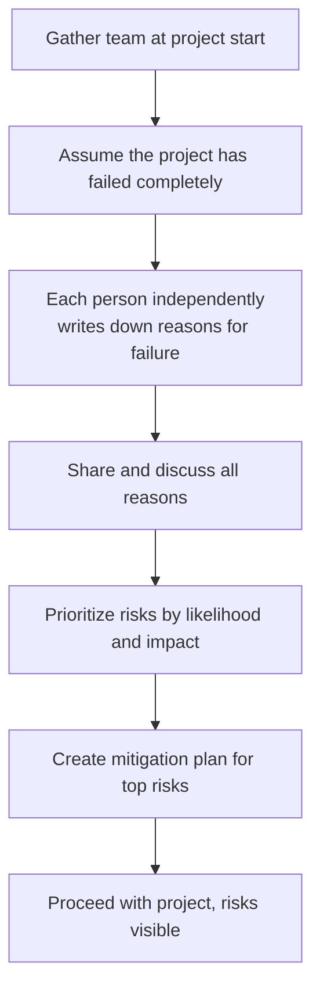
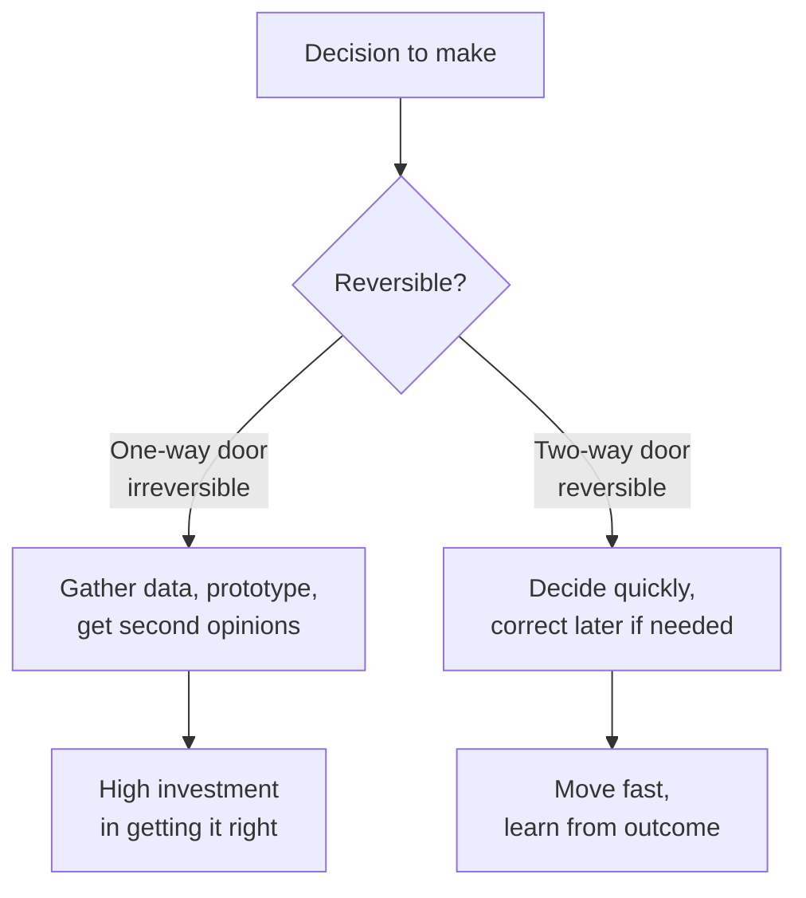

import TawkWidget from '../../../../components/TawkWidget.astro';
import UniversalContentContributors from '../../../../components/UniversalContentContributors.astro';
import InArticleAd from '../../../../components/InArticleAd.astro';
import Copyright from '../../../../components/Copyright.astro';
import BionicText from '../../../../components/BionicText.astro';
import TailwindWrapper from '../../../../components/TailwindWrapper.jsx';
import { Tabs, TabItem } from '@astrojs/starlight/components';
import { Card, CardGrid, Badge, Steps, LinkButton, FileTree } from '@astrojs/starlight/components';

<UniversalContentContributors 
  contributors={frontmatter.contributors}
/>


import CriticalThinkingEngineersComments from '../../../../components/critical-thinking-engineers/CriticalThinkingEngineersComments.astro';

The motor of a borehole pump burns out for the second time in three years. A rewind costs 600 USD and a new motor costs 1,500 USD. The site has no water, three people have three opinions, and the choice goes to the person who speaks with the most confidence. Most engineering losses come from decisions like this one, not from wrong calculations. This lesson gives you tools that put a decision on paper where it can be checked: a decision matrix, expected cost, the premortem, the checklist, and a way to judge how much time a decision deserves. #DecisionMaking #Engineering #CriticalThinking

## Decision Matrices: Making Trade-offs Visible

When several things matter at once, the mind tends to decide on the one it thought of last. A decision matrix is a table that prevents this. You write down the criteria (the things that matter), give each a weight for its importance, and give each option a score on each criterion.

### Example: Choosing a Pump

You must choose one of three borehole pumps. You care about energy use, purchase price, spare parts in your town, service support and delivery time.

<Steps>
1. **List your criteria.** Energy use, price, spare parts, service, delivery.
2. **Assign weights from 1 to 5.** Energy is the largest cost over ten years (weight 5). Price matters (4). Spare parts decide how long a failure lasts (3). Service and delivery matter less (2 each).
3. **Score each option.** Rate each pump from 1 (poor) to 5 (good) on each criterion.
4. **Multiply and add.** Multiply each score by its weight, shown in brackets, and add the column.
</Steps>

| Criterion | Weight | Pump A | Pump B | Pump C |
|-----------|--------|-------|-------|-------|
| Energy use | 5 | 4 (20) | 5 (25) | 3 (15) |
| Purchase price | 4 | 3 (12) | 2 (8) | 5 (20) |
| Spare parts nearby | 3 | 5 (15) | 4 (12) | 3 (9) |
| Service support | 2 | 5 (10) | 3 (6) | 2 (4) |
| Delivery time | 2 | 4 (8) | 4 (8) | 3 (6) |
| **Total** | | **65** | **59** | **54** |

Pump A has the highest total, and the table shows why. Pump B is best on energy and loses on price. Pump C is cheapest and loses on almost everything else. The matrix does not decide for you. It shows the reasons, so that another person can disagree with one number and not with the whole choice.

### Pitfalls of Decision Matrices

<CardGrid>
<Card title="Garbage In, Garbage Out" icon="warning">
A score with no data behind it is an opinion with a number on it. "I feel that pump A has better service" is weaker than "the agent for pump A is 20 km away and the agent for pump B is 400 km away".
</Card>
<Card title="Weight Manipulation" icon="warning">
It is easy to adjust the weights until the option you already like wins. Fix the weights before you score. Better, let one person set the weights and another the scores.
</Card>
<Card title="Missing Criteria" icon="warning">
The matrix judges only what you put in it. If you forget to ask whether the maker will still supply parts in five years, the matrix will not remind you. Ask: "What am I not judging?"
</Card>
<Card title="False Precision" icon="warning">
A score of 4.2 against 3.8 for "service support" claims a precision you do not have. Use whole numbers from 1 to 5, or only low, medium and high.
</Card>
</CardGrid>

### Sensitivity Analysis

Sensitivity analysis asks how much a weight or a score must change before the winner changes. Raise and lower each weight by one point and add the columns again. It takes five minutes.

In the pump table, pump A leads pump B by 6 points, and no change of one point in a single weight removes that lead. The result is firm. If one point had changed the winner, the two options would be closer than the totals suggest, and the criterion that changed it would deserve better data.

## Trade-off Analysis: Making Costs Explicit

<InArticleAd />


A trade-off is a gain that you pay for with a loss somewhere else. A larger pump gives more water and uses more energy. A cheaper material is weaker. A well known product is safer and may perform less well than a new one. Trade-off analysis means writing these costs down. How much writing a decision deserves depends on what is at risk:

```text
  What is at risk             Method             Time
  ──────────────────────────  ─────────────────  ───────
  Little, easy to undo        Decide and adjust  5 min
  Simple, 2 or 3 options      List for, against  15 min
  Several criteria            Decision matrix    45 min
  Much, hard to undo          Matrix, expected   2 to 4
                              cost, premortem    hours
```

### The Iron Triangle (and Its Extensions)

The best known trade-off in projects is between scope (how much is built), schedule and cost. You can fix two of them, and the third follows. More scope in less time needs more money. A fixed budget and a fixed date mean less scope. Engineering has many more: precision against price, proven equipment against better performance, thorough testing against an earlier handover.

### How to Do Trade-off Analysis

<Steps>
1. **State the decision.** What exactly are you choosing between?
2. **List what you gain with each option.**
3. **List what you lose with each option.** Be as exact as in step 2.
4. **Use numbers where you can.** "A little more expensive" is vague. "180 USD more for each unit, and 40 USD a year less energy" can be compared.
5. **Mark what can be undone.** A trade-off that you can reverse later carries less risk.
</Steps>

## Expected cost: repair or replace

Some options are cheap now and carry a risk of a large cost later. To compare them you need one number for each option. The expected cost is that number: the cost you pay for certain, plus each possible later cost multiplied by its probability. It is the average cost you would pay if you faced the same choice many times.

Take the burned motor. The workshop's records show that 5 of the last 10 rewound motors failed again within two years.

<Steps>
1. **Write down what each failure costs.** A second failure means a crane to lift the pump (250 USD) and three days of water by truck (450 USD). After a failed rewind you would also buy the new motor (1,500 USD), so a failure costs 2,200 USD. A new motor that fails is replaced free under its warranty, so that failure costs 700 USD.

2. **Estimate the probabilities.** Rewound motor: 0.50 in two years. New motor: about 0.05.

3. **Calculate the expected cost of the rewind.** $600 + 0.50 \times 2{,}200 = 1{,}700$ USD.

4. **Calculate the expected cost of the new motor.** $1{,}500 + 0.05 \times 700 = 1{,}535$ USD.

5. **Find the break-even point.** The two options cost the same when $600 + p \times 2{,}200 = 1{,}535$, which gives $p = 0.425$. The rewind is the better choice only if fewer than 42.5% of rewound motors fail again.
</Steps>

The rewind is 900 USD cheaper today and 165 USD more expensive on average. The decision rests on one number, the probability that the rewind fails, and step 5 tells you how good that number must be. With a workshop whose record is 3 failures in 10, the rewind would win: $600 + 0.30 \times 2{,}200 = 1{,}260$ USD.

Expected cost is an average. If a single bad result would be a disaster, such as a hospital with no water, the worst case decides, not the average.

## Premortems: Imagining Failure Before It Happens

<InArticleAd />


A postmortem is the study of a project after it has failed. A premortem is done before the project starts, when the findings can still be used.

The technique comes from psychologist Gary Klein, and it was popularized by Daniel Kahneman. Here is how it works:



<Card title="The Premortem Process" icon="rocket">
At the start of the project, say to the team: "It is six months from now and this project has failed completely. Each of you, alone, write down why."

Then read the reasons together. People name many more risks when failure is given as a fact to explain.
</Card>

### Why Premortems Work

The usual question, "What could go wrong?", asks people to doubt a project they want to succeed, so they give small answers. A premortem starts from the failure and asks for the explanation. Naming a risk is then the task, not a sign of disloyalty.

### Premortem in Practice

A team that is about to build a solar pumping system might write:

- "The borehole gave less water in the dry season than in the test, and the pump ran dry."
- "The import of the panels took four months, and the rains came before we could lay the pipe."
- "The array was sized for the sunniest month, so the tank was empty in the cloudy season."
- "Nobody on site was trained, and the first small fault stopped the system for three weeks."

Each one is a risk that can be reduced before any money is spent: a longer pumping test, an earlier order, a sizing check for the worst month, a training day.

## Checklists: The Most Underrated Engineering Tool

<InArticleAd />


Atul Gawande's book "The Checklist Manifesto" documents how simple checklists have saved lives in surgery and aviation. For work with many steps and a high cost of error, do not trust memory. Write the steps down and mark each one.

### Why Smart People Need Checklists

"I know my work, I do not need a list" misses the purpose. A checklist is not for what you do not know. It is for what you know and may forget when you are tired, hurried or interrupted. A pilot knows how to fly and still reads the list before every flight, because one forgotten step can be fatal.

### Engineering Checklists

<Tabs>
<TabItem label="Pump Handover Checklist">
- Is the direction of rotation confirmed?
- Is the running current recorded and below the nameplate value?
- Has the dry running protection been tested, with a witness?
- Are the flow and the pressure recorded at the tank?
- Is the setting depth of the pump written in the site file?
- Does the operator know how to stop the pump and whom to call?
</TabItem>
<TabItem label="Cold Room Handover Checklist">
- Does the room reach its setpoint and hold it for 24 hours with the door shut?
- Is the high temperature alarm tested, and does it reach a person?
- Does the door close fully and is the seal complete?
- Is the defrost time set, and is the alarm limit clear of it?
- Is a second thermometer placed to check the sensor?
</TabItem>
<TabItem label="Code Review Checklist">
- Does the code handle empty and missing inputs?
- Are errors checked and handled?
- Are memory, files and connections released?
- Are the limit cases tested?
- Does the code do what the specification says?
</TabItem>
</Tabs>

### Building Your Own Checklists

The best checklists come from past mistakes. Each time something goes wrong because a step was forgotten, add the step. Over the years the list becomes your experience in a form that a new colleague can use on the first day.

### Read-Do vs. Do-Confirm

Gawande identifies two types of checklists:

<Tabs>
<TabItem label="Read-Do">
Read a step, do it, mark it, read the next. Use this for work that is new or rare, such as commissioning a type of controller for the first time.
</TabItem>
<TabItem label="Do-Confirm">
Do the work from memory, then stop at a fixed point and go through the list to confirm that nothing was missed. Use this for experienced people doing familiar work, such as a technician who finishes a pump service and reads the handover list before leaving the site.
</TabItem>
</Tabs>

Most engineering checklists should be Do-Confirm. The list should not slow an experienced person. It should catch the one step that even an experienced person sometimes forgets.

### Keeping Checklists Useful

A list that is too long is not read. Aim for 5 to 15 items, and split a longer list by stage of the work.
## Second Opinions and Code Review

<InArticleAd />


Code review means that a second person reads a program before it is used. The same practice applies to a design, a quotation or a pump selection. The author is the worst person to find the errors in a piece of work, because the assumptions that produced the errors are still in the author's head.

### Why Fresh Eyes Matter

<Card title="The Curse of Knowledge" icon="information">
Once you know something, it is hard to imagine not knowing it. You know what your drawing or your code is meant to do, so you see what you meant, not what is on the page. A reviewer does not know your intention and sees only the page.
</Card>

### Effective Code Review

A review that says "looks good" after 30 seconds has no value. A useful review:

- Takes the time to understand the work.
- Checks that it is correct and that it is clear.
- Asks about anything unusual or more complex than it needs to be.
- Looks for what is missing: the failure case, the test, the unit.
- Is respectful. The aim is better work, not a defeated author.

## Reversible vs. Irreversible Decisions

<InArticleAd />


Jeff Bezos introduced a useful framework: classify decisions as "one-way doors" (irreversible) or "two-way doors" (reversible), and spend effort in proportion.



### One-Way Door Decisions

These are hard or impossible to undo:

- Where to drill a borehole.
- The size of a pipe that will be buried under a concrete floor.
- A three year contract with one supplier.
- The programming language for a large program.

Take time. Collect data, test on a small scale, ask for a second opinion. An error here is paid for over years.

### Two-Way Door Decisions

These are easy to undo:

- An alarm limit or a setpoint.
- The day of the weekly maintenance round.
- A trial of a new sensor on one machine.
- The layout of a report.

Decide quickly. An error costs little because you can change it next week, and a long discussion costs more than the error.

### The Mistake Most Organizations Make

Most organizations treat two-way doors as one-way doors. Three meetings are held about the layout of a report, and a choice that could be reversed in a day is discussed for weeks. Then every decision is slow, including the ones that deserve the time. Name each decision as one-way or two-way before the discussion starts.

## Disagree and Commit

<InArticleAd />


Two reasonable people can look at the same evidence and reach different conclusions. "Disagree and commit" means that you state your disagreement fully while the decision is open, and once it is made you carry it out with full effort. You do not work slowly, and you do not say "I told you so" if it goes badly.

This works because some decisions have a date, and a team that waits for everyone to agree stops. It also lets you find out that you were wrong.

### When to Escalate Instead

Disagree and commit does not cover a decision that you believe is dangerous, illegal or dishonest. If you believe a decision will cause serious harm, take your concern to the person with the authority to stop it. That protects the team.

## Lessons from NASA: The Challenger Disaster

<InArticleAd />


On January 28, 1986, the Space Shuttle Challenger broke apart 73 seconds after launch, killing all seven crew members. The technical cause was well-established: an O-ring in the right solid rocket booster failed to seal properly in the cold temperatures on launch day. But the deeper cause was a failure of decision-making.

### Normalization of Deviance

Sociologist Diane Vaughan coined the term "normalization of deviance" to describe what happened at NASA. The O-rings had shown signs of damage on previous flights. Each time, the damage was noted, analyzed and accepted, so the standard of "acceptable" slowly moved. What would have alarmed people early in the program became routine.

This is not unique to NASA. It happens in every organization:

- "The pump trips sometimes, but it always starts again after a reset." (Until it does not.)
- "The cold room door does not close fully, but the temperature holds." (Until the hottest week.)
- "The power supply gets hot, but it has not failed yet." (Until it does.)

### Groupthink and Social Pressure

The engineers at Morton Thiokol (the contractor that built the solid rocket boosters) recommended against launching in the cold weather. Their managers overruled them, partly because of pressure from NASA to maintain the launch schedule. The engineers had the data. The managers had the authority. Authority won.

<Card title="Lessons for Engineers" icon="information">
1. Data should drive decisions, not hierarchy.
2. When someone raises a safety concern, the burden of proof should be on those who want to proceed, not on those who want to stop.
3. Schedule pressure is never a valid reason to accept increased risk without explicit acknowledgment.
4. "We got away with it last time" is not evidence that it is safe.
</Card>

## A Personal Decision Framework

<InArticleAd />


Eight questions for any decision that matters:

<Steps>
1. **What am I deciding?** State it in one sentence: "Rewind the motor or buy a new one."

2. **What are my options?** List at least three. If you see only two, you have probably not looked far enough: a different pump size, a hired pump for a month.

3. **What criteria matter?** List them and weight them.

4. **What is the evidence for each option?** Separate data, the opinion of an expert and a guess.

5. **Can it be undone?** If yes, decide quickly. If no, spend more time.

6. **What could go wrong?** Do a short premortem.

7. **Who disagrees, and why?** If everyone agrees at once, someone has not thought or has not spoken.

8. **What would change my mind?** Name the evidence now. It protects you later from defending the decision only because it is yours.
</Steps>

For a two-way door, questions 1, 2 and 5 are usually enough. For a one-way door, answer all eight.

## Common Decision-Making Traps

<InArticleAd />


| Trap | Description | Remedy |
|------|-------------|--------|
| Anchoring | The first number you hear rules your thinking | Write your own estimate before you hear others |
| Sunk cost fallacy | "We have already spent 6 months on this" | Ask: "Starting today, would we choose this?" |
| Confirmation bias | Looking for evidence for the option you prefer | Ask one person to argue against it |
| Analysis paralysis | Studying without end and not deciding | Set a date. Decide two-way doors quickly |
| Availability bias | Giving too much weight to a recent or vivid case | Count cases in the records |
| Bandwagon effect | Choosing what everyone else chooses | Ask whether it fits your own site |

### The Sunk Cost Fallacy in Engineering

A sunk cost is money or time already spent that no decision can bring back. You have spent 3,000 USD this year on repairs to an old generator, and it needs 1,200 USD more. The 3,000 USD is gone whether you repair or replace. Only the costs that are still ahead belong in the comparison. The wish not to "waste" what was spent is strong, and it is the trap.

Ask: "If we started today, knowing what we know, would we choose this?" If the answer is no, continuing is the waste.

<Card title="The Concorde Fallacy" icon="information">
The Concorde supersonic airliner is the classic example. The British and French governments continued to fund it long after it was clear that it would never be commercially viable, because neither wanted to "waste" the billions already spent. The aircraft never came close to recovering its development cost. The sunk cost fallacy is sometimes called the "Concorde fallacy" for this reason.
</Card>

## Decision Speed and Reversibility in Practice

<InArticleAd />


Three cases show how much effort a decision deserves.

### Scenario 1: An alarm limit

A cold room must stay below 5 °C. Should the high temperature alarm be set at 6 °C or 7 °C?

This is a two-way door. Set it at 6 °C, count the false alarms for two weeks, and adjust. Ten minutes of thought are enough.

### Scenario 2: A pump for a deep borehole

You are choosing the pump and the rising pipe for a borehole 120 m deep that must serve a village for fifteen years.

This is a one-way door. A wrong choice means a crane, days without water and a second purchase. Spend weeks: use the pumping test data, compare pump curves, ask about spare parts in ten years, and get a second opinion on the sizing.

### Scenario 3: A cloud provider

Your monitoring system needs servers that you rent from a cloud provider. Which one?

This is closer to a one-way door than it looks. Each provider has its own services and tools, and the longer you build on them, the harder it is to move. Compare prices at the size you expect to reach, not at the free starting level, and keep the parts that are specific to one provider in one place.

## Building Good Decision Habits

<InArticleAd />


### Keep a Decision Journal

After a decision that matters, write down:

- What you decided and why.
- The options you rejected.
- The evidence and the risks you saw.
- What would change your mind.

Read the journal six months later. Were the risks you named the ones that came? This is the only way to learn how good your judgment is, because memory rewrites the reasons after the result is known.

### Decide, Then Execute

A good decision carried out with energy is better than a perfect one carried out with doubt. When the work of deciding is done, commit, set a date to review ("we look at this choice again in three months") and work until then.

The exception is news that changes the basis of the decision. If the supplier you chose stops making the product, do not wait for the review date.

## Exercises

<InArticleAd />


1. **Decision matrix.** You must choose one of three suppliers for a standby generator. Build a matrix with at least five criteria and weights, and score each supplier. Then change one weight by one point at a time. Does the winner change?

2. **Expected cost.** A gearbox makes a new noise. An overhaul now costs 800 USD. If you wait, there is a chance $p$ that it fails within the year, with a repair of 3,000 USD and lost production of 2,000 USD. For which values of $p$ is the overhaul cheaper? What data would give you $p$?

3. **Premortem.** Choose a project you are working on. Write five specific reasons why it could fail, and for each one an action you could take now.

4. **Reversibility.** List five decisions you made recently. Mark each as a one-way or a two-way door. On which two-way doors did you spend too long?

5. **Challenger case study.** Read the Rogers Commission Report (the official investigation of the Challenger disaster), specifically Chapter V on the launch decision and Chapter VI on the history of the O-ring problem. Identify three specific points where a different decision could have prevented the disaster. What decision-making process would have led to a different outcome at each point?

## Summary

<InArticleAd />


A decision that is written down can be checked. A decision matrix shows the trade-offs and the reasons. Expected cost puts a cheap option with a risk and a dear option without one on the same scale, and shows which probability the choice depends on. A premortem finds risks while they can still be reduced. A checklist protects against forgetting under pressure, and a second reader sees what the author cannot. Spend time on the decisions that cannot be undone and decide the others quickly. The Challenger launch shows what follows when small deviations become normal and authority outweighs data.

<CriticalThinkingEngineersComments />


<InArticleAd />
<TawkWidget />
<Copyright />