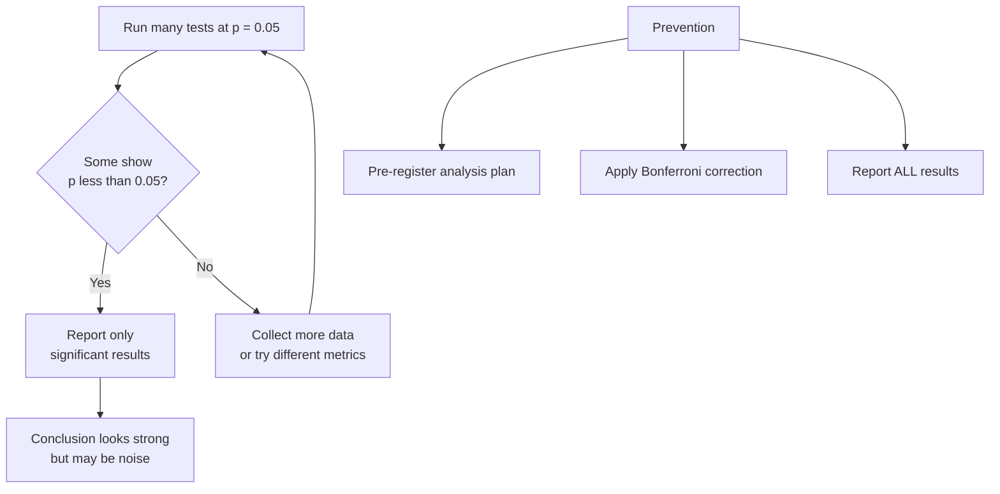

import TawkWidget from '../../../../components/TawkWidget.astro';
import UniversalContentContributors from '../../../../components/UniversalContentContributors.astro';
import InArticleAd from '../../../../components/InArticleAd.astro';
import Copyright from '../../../../components/Copyright.astro';
import BionicText from '../../../../components/BionicText.astro';
import TailwindWrapper from '../../../../components/TailwindWrapper.jsx';
import { Tabs, TabItem } from '@astrojs/starlight/components';
import { Card, CardGrid, Badge, Steps, LinkButton, FileTree } from '@astrojs/starlight/components';

<UniversalContentContributors 
  contributors={frontmatter.contributors}
/>


import CriticalThinkingEngineersComments from '../../../../components/critical-thinking-engineers/CriticalThinkingEngineersComments.astro';

A new pump controller runs for three days without a trip, so the company orders forty more. A vibration alarm "catches 90% of failing bearings", so every alarm is treated as a failing bearing. Both conclusions feel safe, and both come from reading numbers wrongly. This lesson, which follows Alex Reinhart's book "Statistics Done Wrong", covers the errors with data that appear most often in technical work, and shows for each how to check a claim with a few lines of arithmetic. #Statistics #DataAnalysis #CriticalThinking

## The P-Value: What It Actually Means

You change something and the measurement moves. Was it your change, or the ordinary scatter of the measurement? A p-value is the usual tool for that question, and it is very often misread.

The test starts from a cautious assumption called the null hypothesis: there is no real effect, and any difference you see is chance.

<Card title="The Real Definition" icon="star">
A p-value is the probability of getting data at least as extreme as yours, if the null hypothesis is true. It is not the probability that your idea is correct. It does not say that the result is "real". It says nothing about how large or how important the effect is.
</Card>

```text
  Assume there is no real effect
               │
               ▼
  Measure, and find a difference
               │
               ▼
  p = how often chance alone would give
      a difference this large or larger
               │
               ▼
  p < 0.05: chance alone would do this
            less than 1 time in 20
```

### What p = 0.05 Does NOT Mean

| Common Misinterpretation | Why It Is Wrong |
|--------------------------|----------------|
| "There is only a 5% chance the result is due to chance" | The p-value is calculated by assuming that chance is the explanation. It tells you how surprising the data are under that assumption, not how likely the assumption is. |
| "There is a 95% chance our hypothesis is correct" | A p-value says nothing about the probability of a hypothesis. For that you also need to know how likely the hypothesis was before the test. |
| "The effect is large and important" | A very small effect can have p < 0.001 if the sample is large enough. Statistically significant does not mean large enough to matter. |
| "If p > 0.05, there is no effect" | Failing to find an effect does not prove there is none. The test may have had too few samples to detect a real one. |

### Engineering Example

You compare two lubricants in a gearbox, 10 runs with each. It settles at 62.3 °C with lubricant A and 62.1 °C with lubricant B, with p = 0.03: statistically significant. But 0.2 °C in a gearbox whose alarm limit is 85 °C changes nothing you would do. The p-value says that a difference this size would be surprising if the two lubricants were equal, not that the difference matters.

**Rule of thumb:** Always report the size of the effect with the p-value. "Lubricant B runs 0.2 °C cooler (p = 0.03)" lets the reader judge both.

## P-Hacking: Torturing Data Until It Confesses

<InArticleAd />


**What it is:** Running many statistical tests, trying different parts of the data, or reporting only some of the results, until something gives p < 0.05.

The program below shows how easily pure noise gives "significant" results. It tests 20 random hypotheses in which no real effect exists and counts how many give p < 0.05.

```python title="p_hacking_simulation.py"
import numpy as np
from scipy import stats

np.random.seed(42)
n_hypotheses = 20
n_samples = 30  # samples per group
alpha = 0.05
false_positives = 0

print(f"Testing {n_hypotheses} random hypotheses (NO real effect)...\n")
for i in range(n_hypotheses):
    group_a = np.random.normal(loc=0, scale=1, size=n_samples)
    group_b = np.random.normal(loc=0, scale=1, size=n_samples)
    t_stat, p_val = stats.ttest_ind(group_a, group_b)
    if p_val < alpha:
        false_positives += 1
        print(f"  Hypothesis {i+1}: p = {p_val:.4f}  ** 'SIGNIFICANT' (false positive)")

print(f"\nResults: {false_positives} out of {n_hypotheses} tests were 'significant' at p < {alpha}")
print(f"Expected by chance: {n_hypotheses * alpha:.0f}")
print(f"\nLesson: test enough random things and you WILL find 'significant' results.")
print(f"This is p-hacking. The 'discoveries' are pure noise.")
```



<Tabs>
  <TabItem label="How It Happens">
    You try an energy saving setting on 20 different machines. Most show no clear difference. Three show a saving with p < 0.05. You report those three and conclude "the setting saves energy on compressors".

    The problem: if you test 20 things at the p = 0.05 level, you expect about one false positive from chance alone ($20 \times 0.05 = 1$). Three "significant" results in 20 tests is weak evidence: when no real effect exists, chance alone gives three or more about 8% of the time. You may be reporting noise.
  </TabItem>
  <TabItem label="Subtle Forms">
    P-hacking is often done without intent. Common forms:

    - **Optional stopping:** You collect data until the result is significant and then stop.
    - **Removing outliers:** You remove the points that hurt your result and find a reason afterwards.
    - **Subgroups:** You divide the data in different ways until a pattern appears. "It does not help overall, but it helps on the night shift."
    - **Many measures:** You measure many outcomes and report only the one that was significant.
  </TabItem>
  <TabItem label="How to Prevent It">
    - **Write the plan first.** Before you collect data, write down what you will test, how many tests you will run, and what threshold you will use.
    - **Correct for the number of tests.** The section on multiple comparisons below shows how.
    - **Report all results.** A reader who sees "3 of 20 machines improved" draws a different conclusion from one who sees "compressors improved".
  </TabItem>
</Tabs>

## Small Sample Sizes: The Engineering Epidemic

<InArticleAd />


The most common error with data in daily technical work is a strong conclusion from very few cases.

<Card title="The Core Problem" icon="warning">
The new controller ran three days without a trip. The repaired pump started five times out of five. The program passed on the 3 boards you tested. In each case the sample is far too small to support the conclusion. Three days do not include a hot afternoon, a low tank or a weak supply. Three boards do not cover the spread between components or between factories.
</Card>

### The "We Ran It 3 Times" Problem

How often do 3 tests miss a real defect? The program below takes items from a population in which 10% are defective, three at a time, and counts how often all three pass.

```python title="small_sample_trap.py"
import numpy as np

np.random.seed(42)
n_simulations = 10000
n_tests = 3
defect_rate = 0.10

# Each simulation: draw n_tests items, each defective with probability defect_rate
results = np.random.random((n_simulations, n_tests)) < defect_rate
batches_all_pass = np.sum(~np.any(results, axis=1))

miss_pct = 100 * batches_all_pass / n_simulations
theory_pct = 100 * (1 - defect_rate) ** n_tests

print(f"Simulated {n_simulations} batches of {n_tests} tests (true defect rate = {defect_rate*100:.0f}%)\n")
print(f"Batches where ALL {n_tests} tests passed (defect hidden): {batches_all_pass} / {n_simulations}")
print(f"Simulated miss rate:   {miss_pct:.1f}%")
print(f"Theoretical miss rate: {theory_pct:.1f}%  [= (1 - {defect_rate})^{n_tests}]")
print(f"\nWith only {n_tests} tests, you miss a {defect_rate*100:.0f}% defect rate ~{theory_pct:.0f}% of the time.")
print(f"'We tested 3 boards and they all passed' is dangerously weak evidence.")
```

<Tabs>
  <TabItem label="The Scenario">
    A new pump controller is installed at one site. It runs for 3 days without a nuisance trip, and it is approved for all sites.

    Suppose the controller has a fault that causes a trip on 10% of days. The chance that 3 days pass with no trip is $0.9 \times 0.9 \times 0.9 = 0.729$, or 73%. A fault that appears on 5% of days stays hidden 86% of the time. The three clean days have proved almost nothing.
  </TabItem>
  <TabItem label="The Math">
    If a failure appears with probability $p$ in each run, the probability that $n$ runs all pass is:

    $$
    P(\text{no failures in } n \text{ runs}) = (1 - p)^n
    $$

    | Failure Rate | 3 Runs | 10 Runs | 30 Runs | 100 Runs |
    |-------------|--------|---------|---------|----------|
    | 1% | 97% hide | 90% hide | 74% hide | 37% hide |
    | 5% | 86% hide | 60% hide | 21% hide | 0.6% hide |
    | 10% | 73% hide | 35% hide | 4% hide | 0.003% hide |

    Read one row: a fault that appears 5% of the time is still hidden after 30 clean runs about 1 time in 5.
  </TabItem>
  <TabItem label="The Fix">
    Decide the failure rate you must be able to detect and how sure you need to be. Then calculate the number of runs. To be 95% sure that a failure rate of 1% would have shown itself, you need about 300 runs with no failure ($\ln(0.05) / \ln(0.99) \approx 298.1$, which rounds up to 299). If you cannot run that many, say so: "3 days, no trips, which cannot exclude a fault on 1 day in 10."
  </TabItem>
</Tabs>

## Overfitting: Memorizing Noise

<InArticleAd />


**What it is:** Building a model that fits the data you have very closely and fails on new data, because it has fitted the noise in your data and not the pattern under it.

<Tabs>
  <TabItem label="An Energy Baseline">
    You have 5 monthly energy bills for a factory. You fit a formula for monthly energy with four inputs: outdoor temperature, production, humidity and number of working days. With its constant term the formula has 5 adjustable numbers, and 5 adjustable numbers can pass exactly through any 5 points. The fit is perfect and it means nothing. In the sixth month the formula can be wrong by a wide margin, and any "saving" calculated from it is wrong by the same amount.
  </TabItem>
  <TabItem label="How to Detect and Prevent">
    - **Keep some data back.** Never test a model on the same data you used to build it. Fit on some months and check on the others.
    - **Prefer the simpler model.** A straight line that holds on new data is worth more than a complicated curve that fits only the old data.
    - **Count your data against your adjustable numbers.** You need many more points than numbers to adjust.
    - **Distrust a perfect fit.** Real measurements have scatter. A model with none has probably fitted the scatter.
  </TabItem>
</Tabs>

## Confounding Variables: Correlation Is Not Causation

<InArticleAd />


**What it is:** A confounding variable is a third factor that moves both of the things you are comparing, so that they rise and fall together although neither causes the other.

### Engineering Confounds

| Observed Correlation | Apparent Conclusion | Confounding Variable |
|---------------------|---------------------|---------------------|
| Energy use fell in the month after a "power saver" was fitted | The device saves energy | The month was cooler, so the cooling plant worked less |
| Pumps serviced by one contractor fail less often | That contractor does better work | That contractor has the newer sites |
| Servers with more memory crash less often | Memory prevents crashes | Servers with more memory are newer |

### How to Counter Confounding

<Steps>
1. **Ask "what else changed?"** For every correlation, list the other things that could explain it.

2. **Change one thing.** To test a new setting, change only that setting: same machine, same load, same time of day.

3. **Randomize when you can.** If chance decides which units get the change, the factors you did not think of are spread evenly between the two groups.

4. **Be modest about data you only observed.** It can suggest a cause. It seldom proves one.
</Steps>

Confounding has a lesson of its own, [Correlation, Causation, and Evidence](/education/critical-thinking-engineers/correlation-causation-evidence/), with a worked energy saving claim.

## Base Rate Neglect

<InArticleAd />


**What it is:** Judging a test result or an alarm without asking how common the thing it looks for is. That overall frequency is called the base rate.

<Tabs>
  <TabItem label="Worked Case">
    A site has 1,000 motors. A vibration alarm sounds for 90% of the motors that have a failing bearing. It also sounds, wrongly, for 5% of the healthy motors. At any time about 2% of the motors have a failing bearing. The alarm sounds on motor 417. How likely is it that the bearing is failing?

    Most people say about 90%. Count the motors:

    | | Motors | Alarm sounds |
    |---|--------|--------------|
    | Failing bearing | 2% of 1,000 = 20 | 90% of 20 = 18 |
    | Healthy | 980 | 5% of 980 = 49 |
    | Total | 1,000 | 67 |

    Of the 67 alarms, only 18 are real: $18 / 67 = 27\%$. Nearly three alarms in four are false, from an alarm that does catch 90% of the faults. The healthy motors are so many that even 5% of them is more than all the faulty ones.

    This is why people stop listening to alarms. The remedy is not to ignore them but to lower the false alarm rate, or to add a second, different check before a technician is sent.
  </TabItem>
  <TabItem label="The Classic Puzzle">
    A disease affects 1 person in 10,000. A test is "99% accurate": it finds 99% of the people who have the disease and wrongly marks 1% of those who do not. Your result is positive. How likely is it that you have the disease?

    Most people say 99%. The answer is about 1%. Among 10,000 people, 1 has the disease and the test finds that person. Among the 9,999 others, the test wrongly marks about 100. So there are about 101 positive results and 1 of them is real: $1/101$, about 1%.
  </TabItem>
  <TabItem label="How to Counter">
    Before you read a test result or an alarm, ask: "How common is this in the first place?" Then count, as in the table: how many real cases, how many of them are caught, and how many false alarms come from all the rest.
  </TabItem>
</Tabs>

## Multiple Comparisons Problem

<InArticleAd />


**What it is:** When you run many tests at once, the chance that at least one gives a false positive rises quickly.

<Card title="The Jelly Bean Study" icon="warning">
A well known xkcd comic shows it. Scientists test whether jelly beans cause acne, one color at a time, for 20 colors. At the p = 0.05 level they should expect 1 false positive in 20 tests. Green jelly beans give p < 0.05, and the newspaper prints: "Green Jelly Beans Linked to Acne". The 19 colors that showed nothing are not mentioned.
</Card>

### In Engineering

After a service visit you compare 15 sensor channels before and after, each with p = 0.05 as the threshold. If the service changed nothing, you still expect $15 \times 0.05 = 0.75$ false positives, and the chance of at least one is $1 - 0.95^{15} = 54\%$. So one channel with p = 0.04 is more likely noise than a real change.

**The Bonferroni correction:** Divide the threshold by the number of tests. For 15 tests, accept a single result only if $p < 0.05/15 = 0.0033$. This is strict, and it prevents false discoveries.

**False Discovery Rate (FDR) control:** A less strict method that limits the expected share of false discoveries among all discoveries. The Benjamini-Hochberg procedure is the usual one.

:::tip[Instrument it]
Sensor data lies in quiet, statistical ways. Sample a vibration signal too slowly and a real fault aliases into a frequency that is not there; log only when a threshold trips and your history is biased toward trouble it never saw the start of; average away a transient and the spike that mattered disappears. Before you trust a number off an instrument, whether on a scope or on a live dashboard like [siliconwit.io's public devices](https://siliconwit.io/public-devices), ask how it was sampled, how it was aggregated, and what it left out. A measurement you cannot defend statistically is one you should not act on.
:::

## Practical Checklist for Engineering Data

<InArticleAd />


Before you draw a conclusion from data, go through this list:

<Steps>
1. **Sample size.** Is it large enough to show the effect you care about? Have you calculated how many you need?

2. **Effect size.** If the result is statistically significant, is it also large enough to matter?

3. **Multiple comparisons.** Did you run more than one test? Did you correct for it?

4. **Confounding variables.** What else changed between the two conditions?

5. **Selection.** Does your sample represent the whole, or only the cases that passed some filter?

6. **Overfitting.** Are you checking your conclusion on the same data that gave it to you?

7. **Base rate.** How common is the event you are detecting? Could most detections be false?

8. **Repeatability.** Would another person who repeated the test get the same result? Has anyone tried?
</Steps>

## Exercises

<InArticleAd />


### Exercise 1: P-Value Interpretation

A colleague reports: "Pump A used 45 kWh a day on average and pump B used 43 kWh, with p = 0.02. Pump B is significantly more efficient." Write a reply that says what this result does and does not tell you. Consider the size of the effect, the number of days measured and what else differed between the pumps.

### Exercise 2: Sample Size Calculator

A fault appeared in 2% of pump starts. After a repair, how many starts with no fault do you need to be 95% confident that the fault is gone? (Hint: use the formula $n = \ln(1 - \text{confidence}) / \ln(1 - \text{failure rate})$, so $n = \ln(0.05) / \ln(0.98) \approx 148.3$, which rounds up to 149.)

### Exercise 3: Confound Spotter

Your company started a new maintenance plan six months ago. Since then, breakdowns have fallen by 20%, and your manager gives the plan the credit. List at least three confounding variables that could explain the fall without the plan.

### Exercise 4: Base Rate Calculation

An alarm sounds for 95% of real faults and for 3% of healthy machines. If 5% of machines have the fault, what share of the alarms are real? Count it for 1,000 machines, step by step.

### Exercise 5: Multiple Comparisons Audit

Find a technical report that tests several hypotheses. Did the author correct for the number of tests? If not, how many of the "significant" results could be false positives?

## What Comes Next

<InArticleAd />


The next lesson, [How to Lie with Charts and Data](/education/critical-thinking-engineers/lying-with-charts-data/), moves from numbers to pictures: how a cut axis, a chosen time window or a stretched scale can make a chart say what its author wants.

## Seen in the field

<InArticleAd />


Detecting a small effect inside a large source of variation is first a problem of measurement design, and the fix is usually to pick a channel where the effect is not competing with anything. Stored grain shows this well: respiration produces both carbon dioxide and heat, but the heat is buried inside an eleven degree swing driven by the weather while the carbon dioxide has essentially one source. The comparison is worked through in [the silo never got hot](/blog/remote-monitoring/grain-storage-spoilage-monitoring/).

<CriticalThinkingEngineersComments />


<InArticleAd />
<TawkWidget />
<Copyright />
