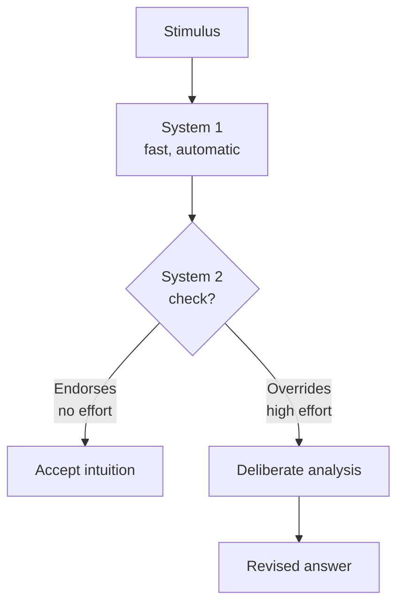

import TawkWidget from '../../../../components/TawkWidget.astro';
import UniversalContentContributors from '../../../../components/UniversalContentContributors.astro';
import InArticleAd from '../../../../components/InArticleAd.astro';
import Copyright from '../../../../components/Copyright.astro';
import BionicText from '../../../../components/BionicText.astro';
import TailwindWrapper from '../../../../components/TailwindWrapper.jsx';
import { Tabs, TabItem } from '@astrojs/starlight/components';
import { Card, CardGrid, Badge, Steps, LinkButton, FileTree } from '@astrojs/starlight/components';

<UniversalContentContributors 
  contributors={frontmatter.contributors}
/>

import PodcastEmbed from '../../../../components/PodcastEmbed.astro';

import CriticalThinkingEngineersComments from '../../../../components/critical-thinking-engineers/CriticalThinkingEngineersComments.astro';

The cold room alarm sounds at two in the morning. The last three times it was the door switch, so the technician silences it and goes back to sleep. This time the compressor has stopped, and by morning the stock is lost. Nobody was careless. A fast, automatic part of the mind answered before the careful part was asked. This lesson describes the two ways of thinking that the psychologist Daniel Kahneman set out in his book "Thinking, Fast and Slow", shows where the fast one can be trusted, and gives you ways to call on the slow one before a quick judgment becomes an expensive one. #CriticalThinking #SystemThinking #EngineeringMindset

<PodcastEmbed src="https://open.spotify.com/episode/5zYy6KKWhaKklopfVrniVG?si=CbNSLRzvRvqGZ_NMmd3Etg" />

## Two Systems, One Brain

Kahneman describes two ways of thinking that work in every human mind. He named them System 1 and System 2. They are not two places in the brain. They are two styles of work.

<CardGrid>
  <Card title="System 1: Fast Thinking" icon="star">
    Automatic, without effort, and always running. System 1 recognizes patterns and gives you an answer or a feeling at once. It lets an experienced technician hear a pump for two seconds and say "that bearing is failing" without any calculation. It works with heuristics: mental shortcuts built from experience.
  </Card>

  <Card title="System 2: Slow Thinking" icon="setting">
    Deliberate, effortful, and quickly tired. System 2 does step by step reasoning, calculation, and careful comparison of options. You use it when you sit with a pump curve and a pipe drawing and work out whether the pump can deliver the flow. It needs your full attention.
  </Card>
</CardGrid>

System 1 always runs first. It produces an answer, and then System 2 either accepts it, which costs no effort, or checks and replaces it, which costs a lot. Most of the time System 2 accepts what it is given without checking.

### A Quick Self-Test

Answer this before you read further:

> A pressure gauge and its fitting together cost 11 USD. The gauge costs 10 USD more than the fitting. How much does the fitting cost?

If your first answer was 1 USD, that was System 1. Check it: a fitting at 1 USD makes the gauge 11 USD, and the total 12 USD, not 11.

Now the slow way. Let $S$ be the price of the fitting in USD. The gauge costs $S + 10$, so $S + (S + 10) = 11$, which gives $2S = 1$ and $S = 0.50$ USD. The gauge costs 10.50 USD, the total is 11 USD, and the difference is exactly 10 USD.

Most people get this wrong at first. System 1 answered an easier question ("11 minus 10") in place of the real one ("costs 10 more than" is not the same as "costs 10").

## When System 1 Helps Engineers

<InArticleAd />

System 1 is not the enemy. Years of practice build a store of patterns that it can reach at once, and for an experienced person that store is very valuable.

<Card title="Expert Intuition Is Real" icon="approve-check">
When a refrigeration technician looks at frost on a suction line and says "low on charge", System 1 is matching what it sees against hundreds of earlier service visits. That is real expertise, not a guess. Kahneman agrees that expert intuition can be very accurate when it was built by long practice in a regular environment that gives fast feedback.
</Card>

### Where System 1 Shines

| Situation | How System 1 Helps |
|-----------|-------------------|
| Fault finding on familiar equipment | The pattern of earlier faults leads you to the cause faster than a full procedure |
| Walking the plant | An operator notices a new sound, smell or vibration before any instrument shows it |
| Safety checks | "Something is wrong with this setup" is often a hazard pattern that System 1 has recognized |
| Urgent decisions | When a production line is stopped, a fast match to a known pattern is better than a slow analysis |

The condition is that you have long experience in that exact field, and that the field tells you quickly and clearly when you are wrong. A technician who has repaired hundreds of pumps has reliable intuition about pumps. The same technician's intuition about a solar inverter they have never opened is only a guess.

## When System 1 Fails: The Dangerous Heuristics

<InArticleAd />

Heuristics work well in many situations. In others they produce the same error again and again. Three of them cause most of the trouble in technical work.

### Anchoring

The first number you hear pulls your later estimates toward it, even when that number has no basis.

<Tabs>
  <TabItem label="Engineering Example">
    A supplier says: "Customers usually save about 30% on energy with this drive." You have no measurements yet, but 30% is now in your head. When your own calculation gives 8%, it feels too low, and you are tempted to "meet in the middle" at 15% or 20%. The supplier's number had no evidence behind it, and it still moved your estimate.
  </TabItem>
  <TabItem label="How to Counter It">
    Make your own estimate before you hear another person's. In a team, let everyone write their estimate down and show them together, so the most senior person does not set the number for all. When you notice an anchor, ask: "If I had never heard that number, what would I estimate?"
  </TabItem>
</Tabs>

### Availability Heuristic

You judge how likely an event is by how easily an example comes to mind, not by how often it happens.

<Tabs>
  <TabItem label="Engineering Example">
    Last month a borehole pump stopped because a rat had chewed the float switch cable, and it took three days to find. Now, each time a pump stops, your first thought is "cable damage". System 1 offers the newest and most vivid memory. The cause this time may be a tripped overload, a low water level or a blocked strainer, all of which happen more often.
  </TabItem>
  <TabItem label="Everyday Example">
    After news of a plane crash, people judge flying to be more dangerous than driving, although driving is far more dangerous for each kilometre travelled. Dramatic events feel more likely than they are.
  </TabItem>
  <TabItem label="How to Counter It">
    Ask: "Am I choosing this cause because it is the most likely, or because it is the one I remember best?" Then count. Keep a log of the cause of every fault. The worked case below shows what such a log can tell you.
  </TabItem>
</Tabs>

### Substitution

When a question is hard, System 1 quietly answers an easier question in its place.

<Tabs>
  <TabItem label="Engineering Example">
    **Hard question:** "Will this generator still be reliable after ten years in our dust and heat?"

    **Substituted question:** "Does this generator look well made, and did the salesperson seem honest?"

    A prediction about ten years of service has been replaced by a first impression. The two can differ in either direction: a machine that looks rough may run for decades, and a handsome one may fail early.
  </TabItem>
  <TabItem label="Everyday Example">
    **Hard question:** "How happy are you with your life overall?"

    **Substituted question:** "What is my mood right now?"

    Kahneman describes studies by Norbert Schwarz and colleagues in which answers about satisfaction with life were moved by small things, such as the weather or finding a coin a moment before the question.
  </TabItem>
  <TabItem label="How to Counter It">
    For an important decision, write down the real question. Then check that your evidence answers that question and not a simpler one. If you find you are answering "do I like this?" in place of "will this work?", slow down and use System 2.
  </TabItem>
</Tabs>

### A worked case: the alarm that is "always the door"

A cold room holds stock worth 4,000 USD. Its high temperature alarm sounds several times a month, and the night technician has learned to ignore it: "it is always the door". A walk to the room takes ten minutes.

That belief comes from memory, so count instead. The alarm log for the last year has 40 alarms:

| Cause found | Alarms |
|-------------|--------|
| Door left open | 26 |
| Defrost cycle running | 9 |
| Refrigeration fault | 5 |

So the door caused 26 of 40 alarms, which is 65%, not "always". A real fault caused $5 / 40 = 12.5\%$, one alarm in eight.

Now the cost. If an ignored fault loses the stock, each ignored alarm carries an average loss of

$$
0.125 \times 4{,}000 \text{ USD} = 500 \text{ USD}
$$

System 1 compared a ten minute walk with "nothing, it is the door". System 2 compares the same walk with 500 USD. The fast answer was right about the most common cause and still wrong about what to do.

## The WYSIATI Problem

<InArticleAd />

Kahneman uses the phrase "What You See Is All There Is" (WYSIATI) for a dangerous habit of System 1: it builds the best story it can from the information in front of it, and it never asks what information is missing.

<Card title="WYSIATI in Engineering" icon="warning">
An engineer reads a sensor datasheet that shows excellent accuracy at 25 °C. System 1 builds a confident story: "This sensor is accurate." The datasheet says nothing about -20 °C or +85 °C, which are the conditions on site. System 1 did not notice the gap, because it never asks "what am I not seeing?"
</Card>

### WYSIATI Shows Up Everywhere

- **Fault reports:** An operator writes "pump tripped again". You form a cause at once. The report holds only what the operator noticed. What the tank level was, what else was running and what the weather was doing are missing, and System 1 does not ask for them.

- **Project planning:** You estimate from the tasks you know about. System 1 adds no time for the tasks nobody has discovered yet, although some always appear.

### The Counter: A Pre-mortem

Before you commit to a decision, imagine that six months have passed and it has gone badly. Ask: "What went wrong?" This makes System 2 produce the missing information that System 1 ignored.

## Cognitive Ease and Engineering Decisions

<InArticleAd />

Cognitive ease is how smoothly the mind takes in a piece of information. An idea that is clearly presented, often repeated or close to something you met recently feels more true, whether it is true or not.

### How Cognitive Ease Affects Engineers

| Factor | Effect on Judgment |
|--------|-------------------|
| Familiarity | The brand or tool you have used before feels like the better choice, even when another fits the job better |
| Quality of presentation | A well printed proposal feels more believable than an untidy one with the same content |
| Repetition | "Everyone knows a bigger pump is the safe choice", heard often enough, feels true, even where an oversized pump wastes energy and wears faster |

Well presented ideas are not wrong for that reason. Presentation is simply not evidence, and the mind treats it as if it were.

## Practical Framework: When to Trust Your Gut

<InArticleAd />

Use these two lists to decide between the fast answer and the slow one.

<Card title="Trust System 1 When..." icon="approve-check">
- You have long experience in this exact field, not a neighbouring one
- The field gives clear and fast feedback, so you soon learn when you are wrong
- The situation matches patterns you have seen many times
- A wrong call is cheap to correct
</Card>

<Card title="Override with System 2 When..." icon="warning">
- The field or the problem is new to you
- The decision is hard to reverse
- People on the team have different intuitions
- The problem involves probabilities, statistics or large numbers
- You hear yourself say "obviously" or "clearly" about something complicated
</Card>

### A Decision Journal

A decision journal is one of the most useful tools against these errors. When you make an important technical decision, write down:

<Steps>
1. **The decision and the alternatives you considered.** Writing them makes System 2 work.

2. **Your confidence level.** "I am 80% sure this is the right pump" gives you something to check later.

3. **The key assumptions.** What must be true for this decision to succeed?

4. **What would change your mind.** If you name the evidence now, you cannot explain it away later.

5. **Review every three months.** Compare what you predicted with what happened. In time you learn where your intuition is reliable and where it is not.
</Steps>

## Exercises

<InArticleAd />

### Exercise 1: Decision Audit

Think about the last three important technical decisions you made (a repair or replace choice, a supplier, a time estimate). For each one:
- Did you use System 1 (a quick judgment) or System 2 (a deliberate analysis)?
- If System 1, did it rest on real experience with feedback, or on a shortcut?
- Would the result have been different with the other system?

### Exercise 2: Availability Check

The next time you jump to a cause for a fault, stop and write down three other possible causes before you test the first. If your site keeps a fault log, count the causes of the last 20 faults and compare the count with what you would have guessed.

### Exercise 3: WYSIATI Drill

Take a decision you are working on and write down everything you know about it. Then write a second list: "What information am I missing that could change my conclusion?" Find at least five items.

### Exercise 4: Substitution Spotter

In your next review meeting, listen for an easy question answered in place of the hard one, such as "Is this person confident?" in place of "Is this estimate based on evidence?"

## Key Takeaways

<InArticleAd />

<CardGrid>
  <Card title="Two Systems" icon="star">
    System 1 is fast, automatic and based on patterns. System 2 is slow, deliberate and logical. System 1 always answers first, and System 2 seldom checks.
  </Card>

  <Card title="Expert Intuition Is Earned" icon="approve-check">
    Trust System 1 only where it was built by long experience in a field with clear and fast feedback. Outside that field it is a guess.
  </Card>

  <Card title="Heuristics Have Costs" icon="warning">
    Anchoring, availability and substitution are the normal way System 1 works, not rare accidents. They touch estimates, fault finding and buying decisions.
  </Card>

  <Card title="Count Before You Decide" icon="setting">
    You cannot switch System 1 off. You can learn the situations where it misleads, and in those situations write the question down and count the cases.
  </Card>
</CardGrid>

## What Comes Next

<InArticleAd />

The next lesson, [Logical Fallacies in Technical Arguments](/education/critical-thinking-engineers/logical-fallacies-arguments/), moves from errors inside your own head to errors in arguments between people: how to recognize a broken argument in a review meeting or a sales presentation, and how to answer it without a quarrel.

<CriticalThinkingEngineersComments />

<InArticleAd />
<TawkWidget />
<Copyright />
